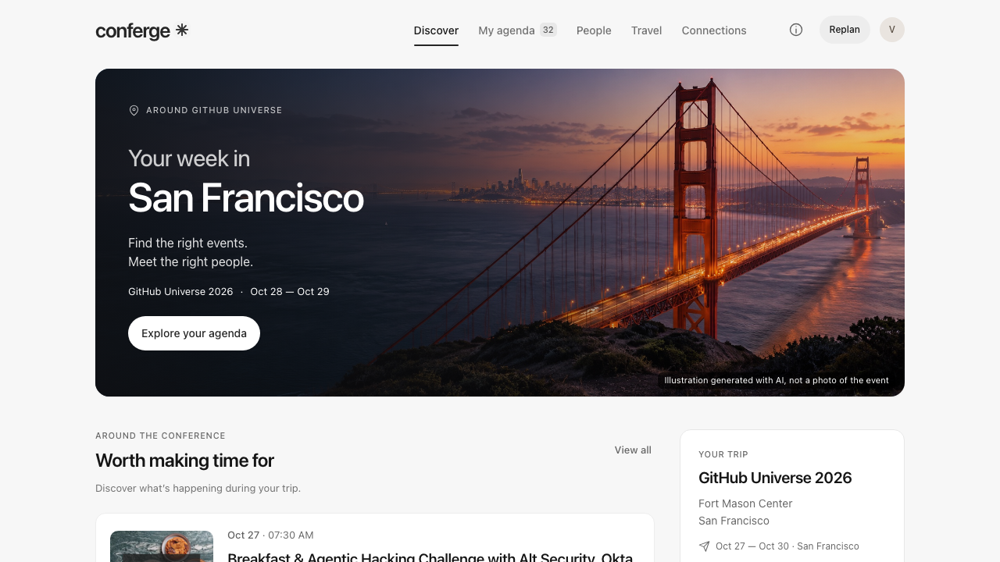
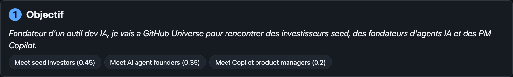
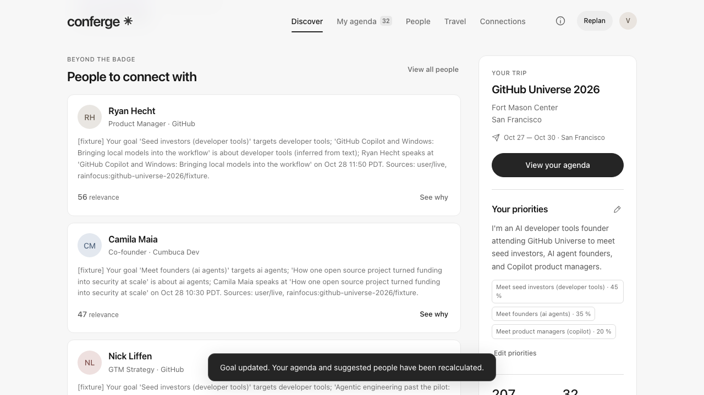
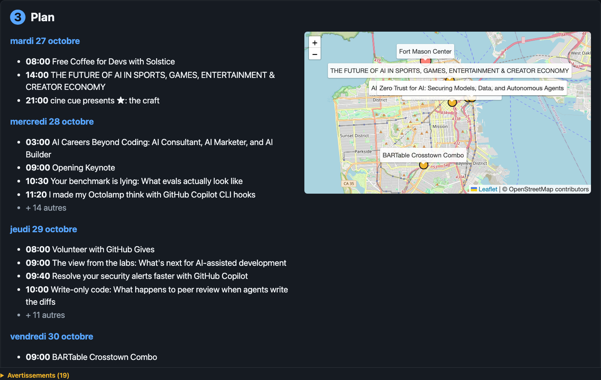
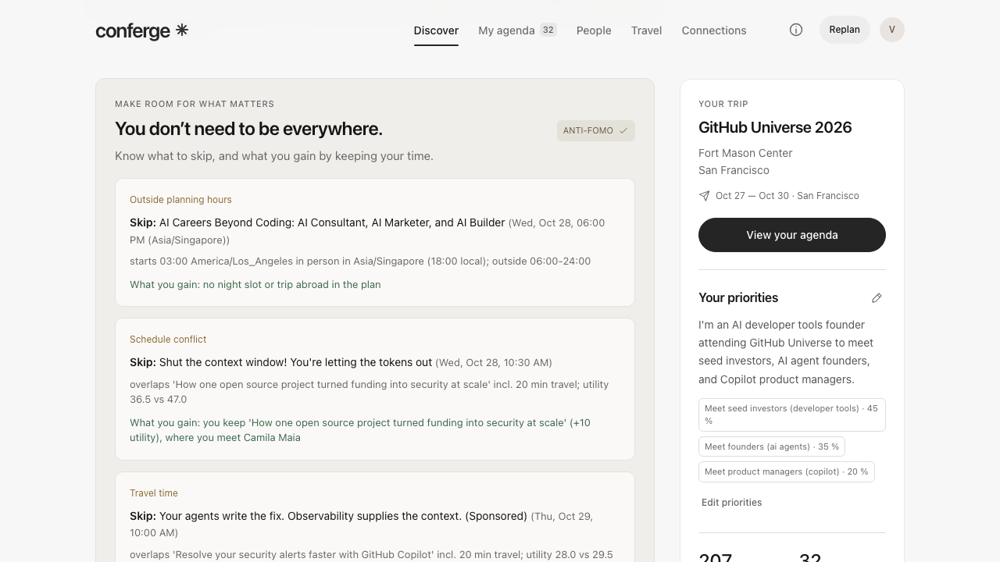
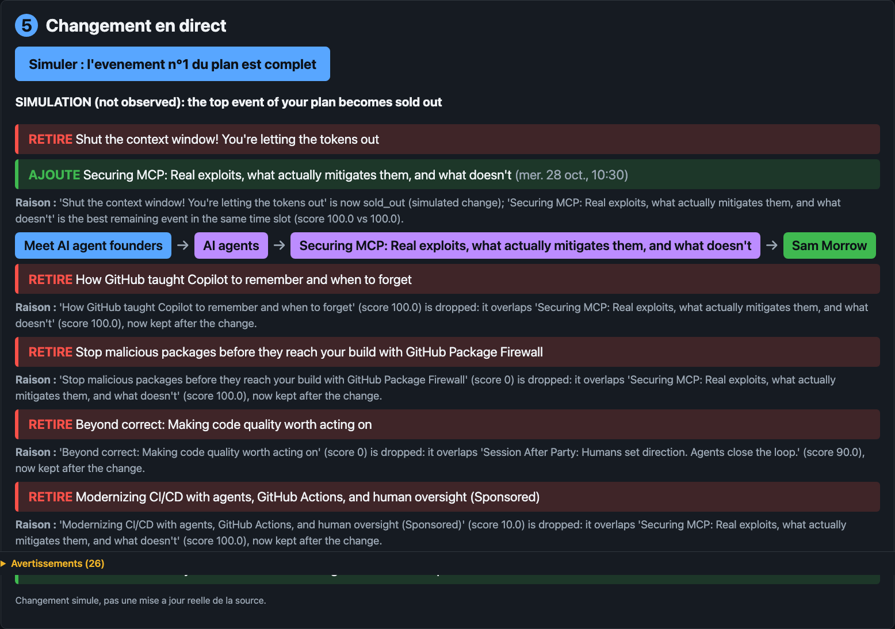

# Conferge

**Plan a conference trip in minutes and maximize the professional opportunities you get out of it.**



## Problem

A big conference is two days, hundreds of sessions, dozens of side events and thousands of people.
Agendas are organised by time slot, not by what you came for, so the people who matter to you stay invisible.
Most attendees go home with a few business cards and the feeling they were in the wrong room.

## What it does

1. **Goal first**: one sentence ("meet seed investors, AI agent founders, Copilot PMs") becomes weighted goals. Rule based, 25 of 25 sentences of the coverage test recognised in French and English.
2. **Event discovery**: official sessions plus side events from Luma, Partiful, Eventbrite and party aggregators, linked to the conference.
3. **Who to meet, and why**: people ranked against your goals, each with the FalkorDB path from goal to person and its sources.
4. **Reverse planning**: a day-by-day plan for the days you are in town, with a map of the venues (straight lines in visit order, labelled as such).
5. **Anti-FOMO and live replanning**: which events to skip (time conflict, travel too long, low score) and what you gain by skipping them; when an event sells out, the plan is recomputed and the diff explains what was removed, what replaces it and why.
6. **Memory and follow-up draft**: "I met this person" is written to the graph and the ranking changes immediately; a follow-up draft built from that graph path and your note is then proposed for validation, never sent.
7. **ROI panel**: four figures for the trip (meetings recorded, qualified contacts, opportunities scored 30 or more, budget against collected flight and lodging prices; spend stays unknown until prices are collected).

## Architecture

```
  Public sources                      Bright Data (when a key is set)
  RainFocus catalog, Luma,            SERP discovery, Web Unlocker,
  Partiful, Eventbrite,               datasets: Google Flights, Booking,
  conference-party aggregators        LinkedIn, Facebook Events
            |                                   |
            +-----------------+-----------------+
                              v
              Connectors (conferge/events, lodging, flights, people)
              every record: source_url, collected_at, source_mode
                              |
                              v
              Assembly + dedup + conference linking (conferge/integration)
                              |
                              v
              FalkorDB graph via GraphStore MERGE only (conferge/graph)
              Conference, Event, Person, Company, Venue, Topic, Goal,
              Opportunity; SPEAKS_AT, HOSTS, WORKS_AT, PART_OF, ABOUT ...
                              |
                              v
              Agents (conferge/agents): planner + networking,
              anti-FOMO optimizer, minimal-change replanner
                              |
                              v
              FastAPI (conferge/api)  ->  one-page UI (static/)
```

- **Bright Data** is the acquisition layer for everything a plain HTTP request cannot reach: long-tail event discovery through SERP, flights and hotels through Web Scraper datasets, LinkedIn profiles for people matching, and unblocking dynamic pages.
  Agents never fetch the web at query time: all reasoning runs on the stored, deduplicated, provenance-tagged graph.
- **FalkorDB** is the opportunity graph: every relation carries its evidence, the "why this person" explanation is a real graph path query, and the user's memory (who they met) lives in the same graph.

## Graph model and Cypher queries

Rankings are computed from FalkorDB traversals; without FalkorDB the API runs in an explicitly degraded mode.

FalkorDB `6.0.3` (pinned in `docker-compose.yml`), client `falkordb==1.8.0`. Labels and relationship types come from an allowlist in `conferge/core/store.py`; every value is a `$parameter`.

**Nodes**: `Conference`, `Event {event_type, start_at, end_at, status}`, `Person {name, title, roles, participation}`, `Company`, `Venue {latitude, longitude}`, `Topic`, `Goal {user_id, priority}`, `Opportunity`, `Lodging`, `FlightOffer`, `Meeting {user_id, kind, at_ms, target_id, reason}`.

**Edges** (each carries `source`, `source_url`, `source_mode`, `confidence`, `observed_at`, `verification`):

```
(Event)-[:PART_OF {relation, relation_score}]->(Conference)
(Event|Person|Goal|Conference)-[:ABOUT]->(Topic)
(Event|Conference)-[:LOCATED_AT]->(Venue)
(Person)-[:SPEAKS_AT]->(Event)
(Person|Company)-[:HOSTS]->(Event)
(Person)-[:WORKS_AT {role, title}]->(Company)
(Person)-[:ATTENDS_CONFIRMED]->(Event)          only with evidence
(Company)-[:EXHIBITS_AT {role}]->(Conference)
(Opportunity)-[:SERVES_GOAL]->(Goal)
(Opportunity)-[:INVOLVES]->(Person|Company|Event)
(Lodging)-[:NEAR {distance_m}]->(Venue)
(Meeting)-[:MET]->(Person)                      one Meeting node per occurrence
(Meeting)-[:INVOLVES]->(Person|Event)           ATTENDED, SKIPPED (with reason), CONTACTED
```

**The 6 main queries, as executed** (`conferge/core/store.py`, `conferge/graph/queries.py`):

```cypher
// 1. Ingestion: the only write path, MERGE on the stable id then SET (GraphStore)
MERGE (n:Person {id: $id}) SET n.name = $prop_0, n.source = $prop_1, ... RETURN n.id
MATCH (a:Person {id: $from_id}), (b:Event {id: $to_id})
MERGE (a)-[r:SPEAKS_AT]->(b) SET r.confidence = $prop_0, ... RETURN a.id, b.id

// 2. People for a goal (one of the bounded signatures; evidence grouped by root source, noisy-OR)
MATCH p = (g:Goal {id: $goal_id, user_id: $user_id})-[:ABOUT]->(:Topic)<-[:ABOUT]-(:Event)
          <-[:SPEAKS_AT]-(person:Person) RETURN person.id, p LIMIT $cap

// 3. Why this person: explicit signatures tried in order (speaker, confirmed attendee,
//    host company, company topic, ...), never a generic shortestPath
MATCH p = (g:Goal {user_id: $user_id})-[:ABOUT]->(:Topic)<-[:ABOUT]-(:Event)
          <-[:SPEAKS_AT]-(person:Person {id: $person_id})
RETURN g.id, length(p), p ORDER BY length(p) LIMIT $cap

// 4. Anti-FOMO conflicts: overlapping events of the conference, with venues
MATCH (a:Event)-[:PART_OF]->(c:Conference {id: $conference_id})<-[:PART_OF]-(b:Event)
WHERE a.id < b.id AND a.start_ts < b.end_ts AND a.end_ts > b.start_ts
OPTIONAL MATCH (a)-[:LOCATED_AT]->(va:Venue) OPTIONAL MATCH (b)-[:LOCATED_AT]->(vb:Venue)
RETURN a.id, a.title, b.id, b.title, va.name, va.latitude, va.longitude, vb.name, vb.latitude, vb.longitude

// 5. Replanning: where else can I meet the people of a cancelled or sold-out event
MATCH p = (e:Event {id: $event_id})<-[:SPEAKS_AT|HOSTS|ATTENDS_CONFIRMED]-(:Person)
          -[:SPEAKS_AT|HOSTS|ATTENDS_CONFIRMED]->(alt:Event)
WHERE alt.id <> e.id AND (alt.status IS NULL OR NOT alt.status IN ['cancelled', 'sold_out'])
RETURN alt.id, alt.title, p LIMIT $cap

// 6. Full-text search (GET /api/v1/search?q=)
CALL db.idx.fulltext.queryNodes('Person', $q) YIELD node, score
RETURN node.id, node.name, node.title, score ORDER BY score DESC LIMIT $limit
```

Query 4 is shortened here (the code also checks that start and end timestamps are not null).

**Indexes** (created at store init, DDL syntax, all `OPERATIONAL` in `CALL db.indexes()`):

```cypher
CREATE INDEX FOR (n:<Label>) ON (n.id)      // one per label: Company, Conference, Event, FlightOffer,
                                            // Goal, Lodging, Meeting, Opportunity, Person, Session, Topic, Venue
CREATE FULLTEXT INDEX FOR (p:Person) ON (p.name, p.bio)
CREATE FULLTEXT INDEX FOR (e:Event) ON (e.title)
```

## Demo case: GitHub Universe 2026

Fort Mason Center, San Francisco, October 28 and 29. Fictional traveller from New York, in town October 27 to 30.

Measured numbers (dataset, graph, Bright Data runs, reachability, tests) are kept in one place: [SUBMISSION.md](SUBMISSION.md), read from the running app.

| 1. Goal | 2. Who to meet, and why |
|---|---|
|  |  |
| **3. Plan and map** | **4. Anti-FOMO** |
|  |  |
| **5. Live replanning** | **6. Meeting recorded** |
|  |  |

## Quickstart

```bash
git clone https://github.com/spicyx9/PatchConferenceHack.git && cd PatchConferenceHack
make up        # FalkorDB 6.0.3 in Docker on 127.0.0.1:6379, Browser on :3000
make install   # Python deps with uv
make demo      # API + UI on http://127.0.0.1:8000, demo data loaded into FalkorDB
```

No `.env` is needed for the demo. Ports:
- If 6379 is already taken by a local Redis, run `FALKORDB_PORT=6380 make up` and `FALKORDB_PORT=6380 make demo` (or put `FALKORDB_PORT=6380` in `.env`). When `make demo` finds a Redis without the FalkorDB module, it stops with "port 6379 is a plain Redis, set FALKORDB_PORT to the FalkorDB port".
- If 8000 is taken, run `make demo DEMO_PORT=8001`. `make demo` checks this before loading anything.

By default `make demo` makes no Bright Data call at startup: travel comes from labelled fixtures and LinkedIn from cached probe files. `make demo DEMO_ARGS="--travel live"` adds the live stays and flights searches. With a key, these took 2 to 3 min on 2026-10-24, because each Bright Data source is capped at 120 s.

`uv run python scripts/run_demo.py --mode live` collects from the public sources instead of the snapshot. Copy `.env.example` to `.env` and set `BRIGHTDATA_API_KEY` (plus `BRIGHTDATA_UNLOCKER_ZONE` and `BRIGHTDATA_SERP_ZONE`) to enable the Bright Data connectors.

## Tracks

- **FalkorDB**: the graph of record, written only through `GraphStore` MERGE methods, queried for explainable goal to person paths, conflicts, replanning impact and meeting memory.
- **Bright Data**: SERP discovery, Web Unlocker, Google Flights, Booking and LinkedIn datasets are implemented behind one client (`conferge/core/brightdata.py`); without a key they report `missing_credentials` instead of inventing data.
- **Qodo**: installed on the repository as the GitHub app `qodo-code-review[bot]`; it posted a PR summary on pull requests 6 and 7 and its full review on pull request 6 failed on Qodo's side. No Qodo finding has been acted on yet.

## Honesty: live vs fixture today

Checked against the code on main (2026-10-24) and the wiring audit of 2026-10-24 (read-only audit, not yet merged).

- **Live and working without keys**: official GitHub Universe catalog (RainFocus), Luma, Partiful, Eventbrite and conference-party aggregators (`run_demo.py --mode live`), and the FalkorDB graph itself.
- **The demo runs on a snapshot** of that public collection captured on 2026-10-24: 207 events, 183 people, 122 companies after deduplication, labelled `fixture` in every API response and in the UI badge, so it works offline on stage.
- **Implemented, waiting for a Bright Data key**: SERP discovery, flights, hotels, LinkedIn enrichment. Without `BRIGHTDATA_API_KEY` the client reports "Bright Data key missing", `GET /brightdata` answers `data_source: unknown` with a warning, lodging providers report `missing_credentials`, and flights and stays fall back to fixtures labelled as such.
- **The traveller profile is a fixture even in live mode**: New York, October 27 to 30, budget $2,500 come from `fixtures/api.json`; the budget block carries `source_mode: fixture` in `GET /travel` and a FIXTURE badge in the UI.
- **Live people are the speakers of the official catalog only**: no GitHub or LinkedIn enrichment runs in the demo path.
- **Ground travel is not in the demo**: BART, OSRM and walking connectors exist with a probe (`make probe-travel`) but the demo API does not call them; the map draws straight lines in visit order and says so.
- **A travel proposal books nothing**: the button is "Note" and the API returns `books: false`.
- **Simulations are labelled**: the sold-out change is a simulation; every later response carries a warning until Reset.
- **No LLM in the loop**: goal parsing is rule based (`conferge/agents/planner/goals.py`), the anti-FOMO agent uses templates, ranking is deterministic; no price, attendance or guest list is ever invented. A public speaker is never presented as a confirmed side-event attendee.

## Team

Axel Carron, Ilan Sainte Agathe.
